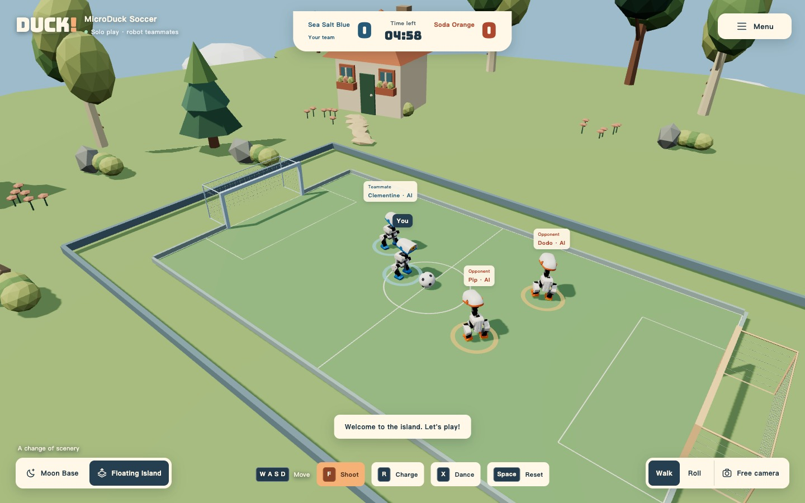
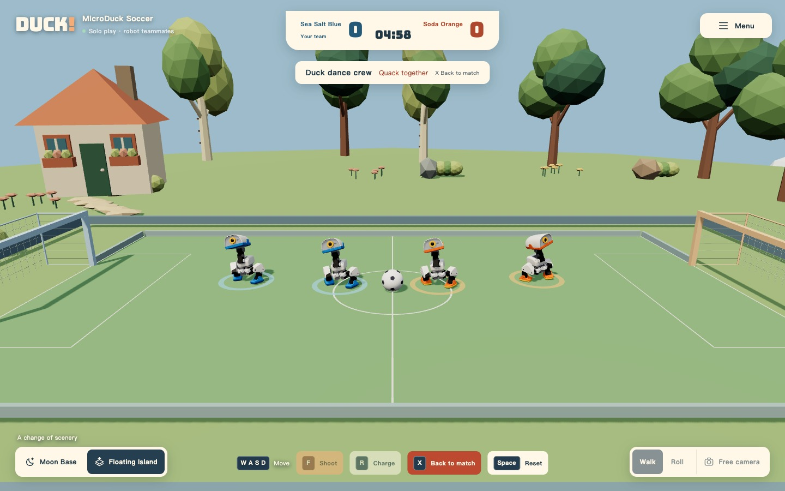

**English** · [简体中文](README.zh-CN.md)

# MicroDuck Robot Soccer

Four robot ducks. One football. A five-minute match on the Moon—or a floating island.

Control a MicroDuck, let the AI take over, charge an opponent, or press **X** to bring the whole flock together for a dance. Robot motion and ball contact run in **MuJoCo**, with learned **ONNX** policies driving the joints. Everything runs in your browser.

**[Play in English](https://wander521.github.io/microduck-robot-soccer/?lang=en)** · [用中文试玩](https://wander521.github.io/microduck-robot-soccer/?lang=zh) · [Controls](#controls) · [Policies](#learned-policies)


<table>
  <tr>
    <td width="50%"></td>
    <td width="50%"></td>
  </tr>
  <tr>
    <td align="center"><strong>Floating Island</strong> · a change of scenery</td>
    <td align="center"><strong>Press X to dance</strong> · learned motion, real physics</td>
  </tr>
</table>

These are actual gameplay captures. The robots use Pollen Robotics' MicroDuck models; this is an independent soccer playground.

<details>
<summary>More screenshots: close-up play, the full arena, and language selection</summary>


<p></p>

</details>

## Play a match

By default, four ducks play **2v2**, with you controlling one duck and the AI controlling the other three. Choose **Autoplay** to watch all four play, or turn off **AI teammates & opponents** to practice alone.

- **Five minutes of active match time.** The team with more goals wins; equal scores mean a draw.
- **3–2–1 kickoff.** After a goal, every duck and the ball return to kickoff positions, then the countdown runs again. Scores and remaining time are preserved.
- The clock pauses during kickoff preparation, dancing, and background tabs. Full time freezes play and scoring.
- **Space** resets everyone and the ball during play without clearing the score or clock. At full time, Space or **Play again** starts a fresh five-minute match.
- Blue and orange teams have matching robot accents. The white shells and eyes keep their original appearance.
- The pitch is **3.15 × 1.86 m**, with **0.72 m-wide, 0.28 m-high** goals and **0.34 m** of robot run-off space outside the touchlines. Slow balls near the boundary receive a gentle nudge back into play.
- Both environments use the same match physics. The Moon keeps normal gravity.

Each tab runs its own single-player match. There are no shared rooms, invitations, or multiplayer servers. The first visit downloads the models, fonts, and WASM from this site; the game does not contact a training server or CDN.

## English and Chinese

Choose **English / 简体中文** on the entry card or in the game menu. Your first visit follows your browser language; later visits remember your choice. Switching language preserves the ongoing match, score, positions, and player-entered names.

Shareable links support `?lang=en` and `?lang=zh`.

## Controls

| Action | Key / control |
| --- | --- |
| Forward / backward | W / S or ↑ / ↓ |
| Turn left / right | A / D or ← / → |
| Shoot | F or **Shoot** |
| Charge | R or **Charge** · 9-second cooldown |
| Open beak and quack | M |
| Reset all ducks and the ball / leave dance and reset | Space |
| Walk into formation and dance / resume from the current position | X |
| Spectate / roam off the pitch | E |
| Follow your duck again | C |
| Look around / zoom | Drag / scroll |
| Free camera | **Free camera**, then WASD to move, Q / E up and down |

Mobile has touch movement, shooting, charging, quacking, dancing, and reset controls. The lower corners switch environments and walking / roller modes. The menu contains language, player name, team, AI, autoplay, and sound settings.

Active shooting and charging require walking mode. Roller mode moves the ball through physical body contact.

## Learned policies

Models live in `public/assets/policies/` and load through [runtime.js](src/physics/runtime.js). The game loads **seven ONNX files**:

| Ability | Model | Origin and use |
| --- | --- | --- |
| Walking and balance | `BEST_alpha_walking.onnx` | Official Pollen Robotics weights; movement, waiting, dance formation, and charging gait |
| Getting up and post-shot recovery | `BEST_alpha_stand.onnx` | Official weights; fall recovery and the one-second transition after a learned soccer kick |
| Roller locomotion | `BEST_roller.onnx` | Official weights, paired with the passive-wheel robot model |
| Left-foot kick | `ball_kick_left.onnx` | Official compatibility path when the new soccer policy is explicitly disabled |
| Right-foot kick | `ball_kick_right.onnx` | Official compatibility path when the new soccer policy is explicitly disabled |
| Ball-aware soccer kick | `football.onnx` | Independently trained for this project: 1,024 environments, 2,000 iterations, deployed checkpoint 1999 |
| Dance | `duckemw_dance.onnx` | Independently trained using the DuckEMW task: 4,096 environments, 4,000 iterations, deployed checkpoint 3500 |

`football.json` currently has `enabled: true`, so both manual and AI shots select `football.onnx`. The three kicking networks are not blended. Explicitly disabling it selects the official left/right kicking path; missing or incompatible files report an error rather than silently changing models.

Team roles, approach paths, aiming, avoidance, and charge timing use a rule-based controller. These decisions call the motion policies. **Team tactics are not an end-to-end multi-agent learned policy, and charging has no separately trained neural network.**

See the [policy inventory and replacement guide](reference/POLICIES.md) (Chinese), [soccer training and evaluation](reference/FOOTBALL_POLICY.md) (Chinese), and [dance policy provenance](reference/DANCE_POLICY.md) (English). These record contracts, checkpoints, hashes, evaluation conditions, and limitations.

## Charging and dancing

**Charge:** R launches a burst along the duck's heading for up to **1.1 seconds**, with a **9-second cooldown** and a peak forward command of **0.8 m/s**. AI ducks look for suitable nearby opponents contesting the ball, with staggered opportunity windows. Charging is unavailable while kicking, recovering, dancing, rolling, or spectating.

The gait remains learned walking. After MuJoCo reports actual opponent contact and enough closing speed, the game adds a bounded impact impulse with equal and opposite reactions. A charge may miss or topple either or both ducks; recovery uses the existing get-up policy. Space cancels charging and clears its cooldown.

**Dance:** X makes the ducks walk into a line and settle before switching to the trained dance policy. An upper-level controller supplies beat and move IDs; ONNX and MuJoCo determine the joints and body motion. Press X again to continue from the reached physical positions. Space leaves the dance and resets everyone. Formation and dancing pause the match clock, and the camera transitions continuously.

## Run locally

Development needs **Node.js 22+** and npm. Players only need a modern browser with WebGL, WebAssembly, and Workers.

```sh
git clone https://github.com/wander521/microduck-robot-soccer.git
cd microduck-robot-soccer
npm ci
npm run dev
```

The default development URL is `http://localhost:5173/`; use the URL printed by Vite if that port is occupied.

Build and preview the same subpath used by GitHub Pages:

```sh
BASE_PATH=/microduck-robot-soccer/ npm run build
BASE_PATH=/microduck-robot-soccer/ npm start
```

Open `http://localhost:5173/microduck-robot-soccer/`. For hosting at a domain root, omit `BASE_PATH`. Serve `dist/` over HTTP; do not open `index.html` directly from disk.

| Command | Purpose |
| --- | --- |
| `npm run dev` | Prepare browser runtime files and start Vite |
| `npm run build` | Produce static `dist/` |
| `npm start` | Preview the build on 127.0.0.1:5173 |
| `npm run preview` | Vite static preview |
| `npm test` | Regression tests, including MuJoCo / ONNX physical tests |
| `npm run dev:native` | Optional local native-inference helper for internal protocol validation |

The playable frontend always uses a Worker. Starting the native helper does not switch the webpage to server inference. Native tests need the platform binary for `onnxruntime-node`; browser builds still use WASM.

## Architecture

```text
Keyboard / touch / team AI
            ↓
Worker: match state → policy selection → ONNX joint targets
            ↓
BAM / XL330 actuator model → MuJoCo dynamics and contacts
            ↓
Physical body and joint state → Three.js interpolation and rendering
```

Physics targets **200 Hz** with a 0.005-second step; policy inference targets **50 Hz**, once every four physics steps. Rendering is separate. Slower hardware may reduce physical simulation speed; the active match clock uses foreground wall time. ONNX runs single-threaded WASM and needs no cross-origin isolation headers.

| Path | Responsibility |
| --- | --- |
| `src/main.js`, `src/style.css`, `index.html` | Rendering, camera, HUD, menus, and input |
| `src/i18n.js` | English / Chinese UI, language selection, and message formatting |
| `src/island-world.js`, `src/team-skin.js` | Floating-island scenery and team colors |
| `src/simulation.js`, `src/match.js`, `src/commands.js` | Shared state, clock, score, reset, and commands |
| `src/football-ai.js`, `src/charge.js` | Team decisions and charge timing |
| `src/physics/worker.js`, `src/physics/browser-runtime.js` | Browser physics loop and asset loading |
| `src/physics/world-core.js`, `src/physics/servo.mjs` | Shared physical world, policy handoff, and actuators |
| `src/physics/trained-dance.js`, `src/physics/dance-formation.js` | Dance inference, walking formation, and in-place exit |
| `public/assets/` | Policies, robots, fonts, and vendored runtime files |
| `reference/` | Sources, contracts, match rules, evaluations, and licenses |
| `docs/media/` | Actual gameplay screenshots and their [provenance](docs/media/SOURCES.md) |
| `scripts/`, `tests/` | Build preparation, match evaluation, and regression tests |

Code, documentation, and Pages deployment use the **main** branch.

## Verify and deploy

```sh
npm test
BASE_PATH=/microduck-robot-soccer/ npm run build
```

Two optional protocol tests are skipped by default because they need a separate native helper. In one terminal, run `PORT=5178 npm run dev:native`; in another:

```sh
RUN_NETWORK_TESTS=1 TEST_SERVER=ws://127.0.0.1:5178 npm test
```

Run full soccer evaluation with real physics and export JSON plus frame records:

```sh
node scripts/evaluate-football.mjs /tmp/microduck-football-evaluation.json all
```

Some historical evaluations used larger goals. Read their conditions before comparing them with current match results.

`.github/workflows/pages.yml` deploys on pushes to `main`: install, test, build, and publish `dist/`. Pages Source must be **GitHub Actions**, and the `github-pages` deployment environment must allow `main`. The base path follows the repository name automatically. No training machine, game backend, or CDN is needed.

## Boundaries and credits

- Team tactics remain rule-based; corner handling, slow-ball play, and coordination have room to improve.
- Decorative scenery does not have complete collision geometry. Robots, the ball, pitch, and goals do.
- An invalid physical state or recovery timeout can reset an individual robot as a fail-safe.
- Scenes and HUD are original implementations. MicroDuck geometry is by **Pollen Robotics**, licensed **CC BY-NC-SA 4.0**. Upstream simulation and training code retain Apache-2.0 attribution; other dependencies use their own licenses.
- This is an independent project using MicroDuck, not an official Pollen Robotics product.

See [THIRD_PARTY.md](THIRD_PARTY.md) for complete resource attribution and [screenshot sources](docs/media/SOURCES.md). Contributions are welcome; include reproduction steps or evaluation evidence when changing physical behavior.
