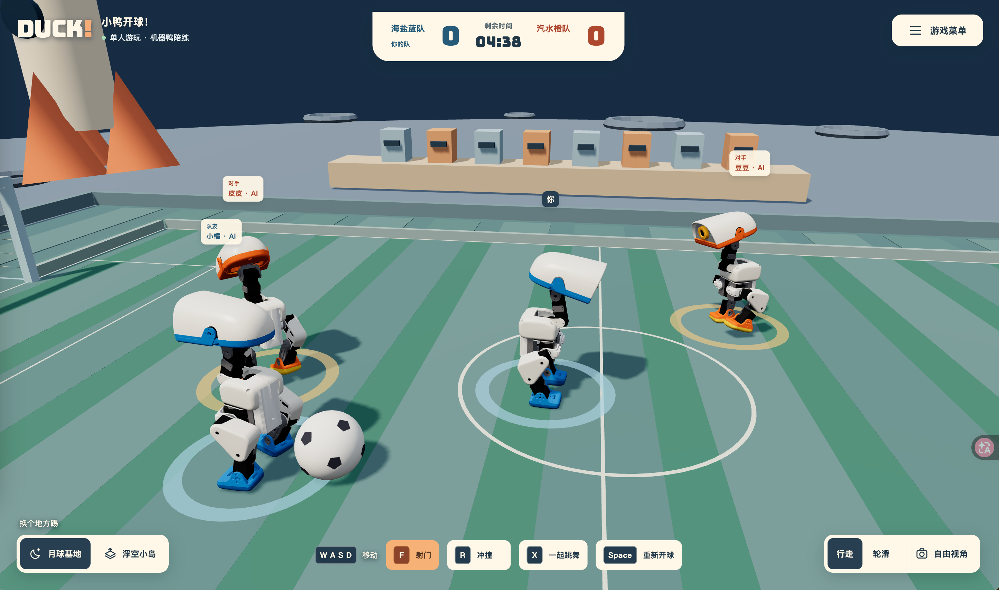
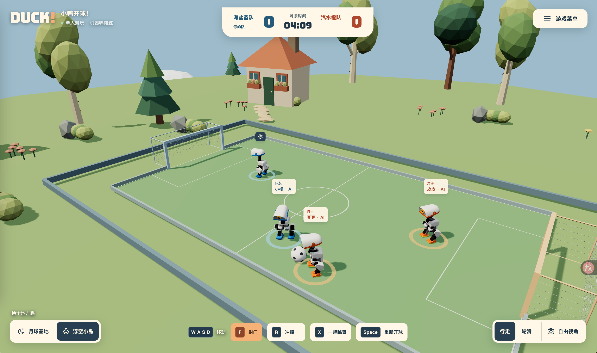
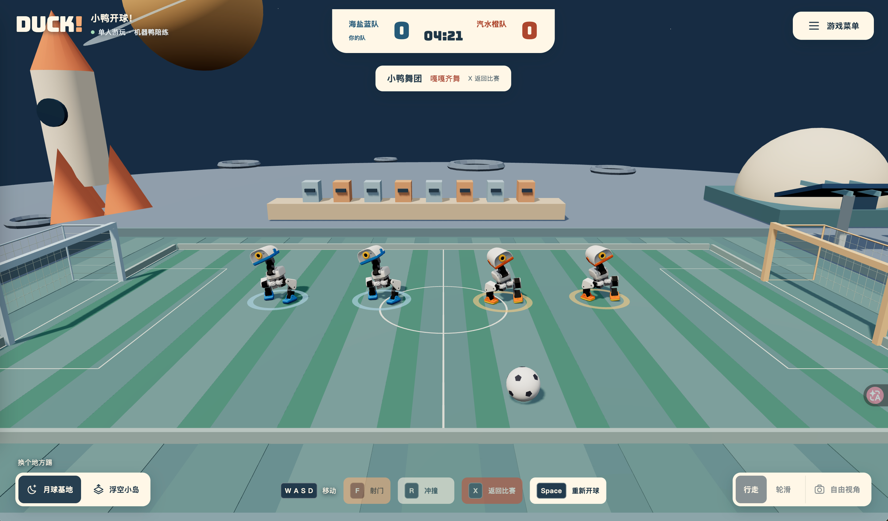
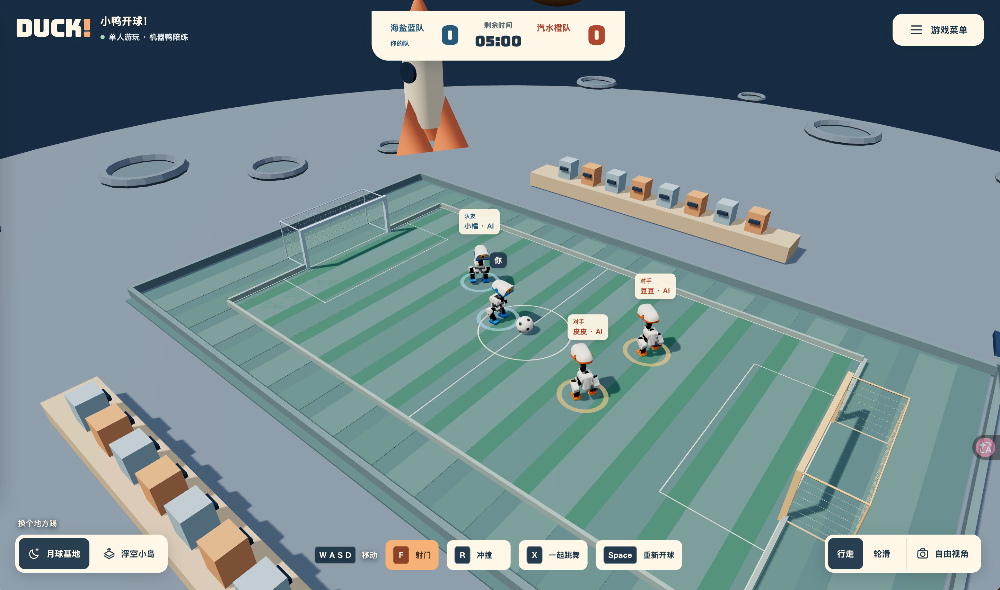
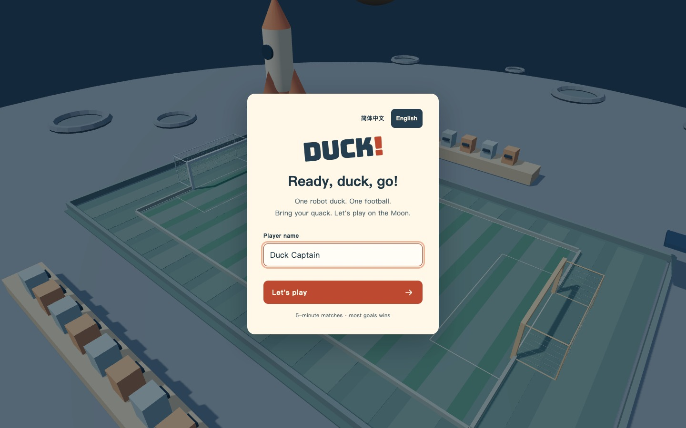
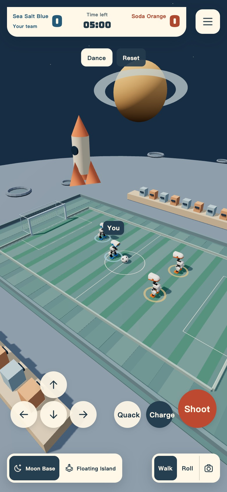
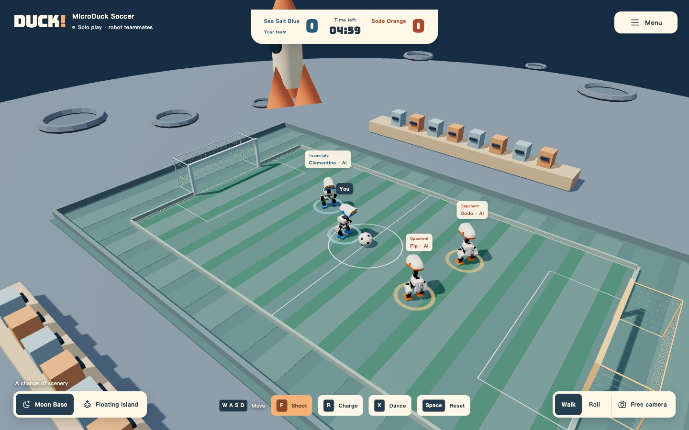

[English](README.md) · **简体中文**

# MicroDuck Robot Soccer · 小鸭开球！

四只 MicroDuck 在月球基地或浮空小岛上进行 2v2 足球比赛，也可以一起列队跳舞。机器人身体、关节、足球和碰撞由 MuJoCo 仿真，动作由 ONNX 策略控制。网页在浏览器内运行，无需游戏后端。

[立即游玩](https://wander521.github.io/microduck-robot-soccer/?lang=zh) · [全部策略](reference/POLICIES.md) · [比赛规则](reference/MATCH_RULES.md) · [资源来源与许可证](THIRD_PARTY.md)



<table>
  <tr>
    <td width="50%"></td>
    <td width="50%"></td>
  </tr>
  <tr>
    <td align="center"><strong>浮空小岛</strong> · 换个地方踢球</td>
    <td align="center"><strong>按 X，一起跳舞</strong> · 真实策略与物理</td>
  </tr>
</table>

截图均来自实际游戏。你可以手动接管一只小鸭，也可以让四只小鸭自动对战。

<details>
<summary>更多画面：全景球场与英文界面</summary>




<p></p>


</details>

## 中英文界面

入场卡片右上角和游戏菜单中都有 **简体中文 / English** 切换。首次访问按浏览器语言选择，之后记住你的选择；切换时不会重置比赛、得分、站位或玩家姓名。链接支持 `?lang=zh` 和 `?lang=en`。

代码、文档与 GitHub Pages 发布统一使用 `main` 分支。

## 游玩与比赛规则

默认蓝橙两队各两只小鸭，你控制其中一只，其余由 AI 控制。菜单中的“自动踢球”可让你的小鸭也交给 AI，实现四鸭自动比赛；关闭“机器鸭队友与对手”可以单独练习。

- 每局 **5 分钟有效比赛时间**，进球多的一队获胜，同分为平局。
- 开场显示 **3、2、1**；进球后保留比分和剩余时间，**全部小鸭与足球归位**，再倒数 3 秒继续。
- 开球准备、跳舞和网页切到后台时暂停比赛计时；终场停止物理运动和计分。
- 比赛中按 Space 让全场归位，保留比分与剩余时间；终场按 Space 或“再来一局”才会清零比分并恢复 05:00。
- 蓝队的头部下壳、嘴部和脚部为蓝色，橙队保留橙色，白色外壳和眼睛保留。
- 球场为 3.15 × 1.86 m，球门名义宽 0.72 m、高 0.28 m。边线外留有 0.34 m 机器人活动区；低速贴边球会轻微回场，方便绕到球后。
- 两个场景使用相同比赛物理，月球基地也采用正常重力。

每个浏览器标签页独立比赛，没有联机、邀请、共享房间或在线人数功能。首次进入需要从本站下载模型、字体与 WASM；运行时不访问训练服务器或 CDN。

## 操作

| 操作 | 按键 / 入口 |
| --- | --- |
| 前进 / 后退 | W / S 或 ↑ / ↓ |
| 左转 / 右转 | A / D 或 ← / → |
| 射门 | F 或“射门” |
| 加速冲撞 | R 或“冲撞”，冷却 9 秒 |
| 张嘴、嘎嘎 | M |
| 全场归位 / 退出舞蹈并归位 | Space |
| 集合跳舞 / 从当前站位继续比赛 | X |
| 观众 / 场外漫游 | E |
| 恢复跟随视角 | C |
| 环顾 / 缩放 | 鼠标拖动 / 滚轮 |
| 自由视角 | 点击“自由视角”，WASD 移动、Q / E 升降 |

手机提供方向键、射门、冲撞和嘎嘎按钮，也可点击舞蹈与归位。底角可以切换场景、行走 / 轮滑；右上菜单可以改名、换队、开关 AI、自动踢球和声音。轮滑依靠身体接触推球，主动射门和冲撞仅支持行走模式。

## 项目使用的策略

模型位于 `public/assets/policies/`，由 [runtime.js](src/physics/runtime.js) 统一加载。当前共加载 7 个 ONNX 文件：

| 能力 | 模型文件 | 来源及当前用途 |
| --- | --- | --- |
| 行走与站立平衡 | `BEST_alpha_walking.onnx` | Pollen Robotics 官方权重；移动、集合列队、等待和冲撞步态 |
| 跌倒起身与射门后恢复 | `BEST_alpha_stand.onnx` | 官方权重；倒地恢复及新踢球策略结束后的姿态衔接 |
| 轮滑 | `BEST_roller.onnx` | 官方权重；带被动滚轮的运动模式 |
| 左脚踢球 | `ball_kick_left.onnx` | 官方权重；关闭新足球策略时使用的兼容路径 |
| 右脚踢球 | `ball_kick_right.onnx` | 官方权重；关闭新足球策略时使用的兼容路径 |
| 感知球位的踢球 | `football.onnx` | 本项目独立训练；当前默认射门策略，1024 环境训练 2000 轮，部署检查点 1999 |
| 舞蹈 | `duckemw_dance.onnx` | 基于 DuckEMW 训练任务独立训练；4096 环境训练 4000 轮，部署检查点 3500 |

当前足球 manifest 的 `enabled: true` 使 F 和 AI 射门优先使用 `football.onnx`，并非三个踢球网络同时混合。显式关闭该开关才会使用官方左右脚模型；文件缺失或契约错误会报错，不会静默切换。

AI 的主攻 / 接应、绕球、对准、避让和冲撞时机由上层规则控制；这些决策再调用动作网络。项目尚未采用端到端训练的多智能体团队足球策略，也没有独立的冲撞神经网络。

输入输出、切换顺序、模型 SHA-256、训练来源与替换步骤见 [策略清单与运行机制](reference/POLICIES.md)。足球评估见 [FOOTBALL_POLICY.md](reference/FOOTBALL_POLICY.md)，舞蹈来源及验证见 [DANCE_POLICY.md](reference/DANCE_POLICY.md)。

## 冲撞与舞蹈

**冲撞：** R 沿当前朝向启动最长 1.1 秒冲刺，目标速度平滑提高至最高 0.8 m/s，冷却 9 秒。AI 在对手靠近足球、双方距离 0.22–0.55 m 且朝向合适时择机发动；每个机器人错开观察窗口。舞蹈、起身、踢球、轮滑和观众状态不能发动。

冲撞使用现有行走策略。MuJoCo 检测到对手真实接触且具有足够接近速度后，施加一次有限的额外撞击冲量，双方承受等大反向作用。是否摔倒取决于接触和身体姿态，可能撞空，也可能双方倒地，再由起身策略恢复。Space 归位会取消冲撞并清除冷却。

**舞蹈：** X 让场上小鸭通过行走策略走到队列、站稳后进入训练舞蹈。节拍和舞种由上层控制器提供，关节与身体运动由 ONNX 和 MuJoCo 决定。再次按 X 从舞蹈结束的实际站位继续踢球；Space 则退出并让全场归位。集合与舞蹈均暂停比赛计时，镜头连续过渡。

## 本地开发与构建

开发环境需要 Node.js 22+ 和 npm；普通玩家只需支持 WebGL、WebAssembly 和 Worker 的现代浏览器。

```sh
git clone https://github.com/wander521/microduck-robot-soccer.git
cd microduck-robot-soccer
npm ci
npm run dev
```

开发地址默认为 `http://localhost:5173/`；端口占用时以终端打印的地址为准。

构建并预览与线上一致的子路径：

```sh
BASE_PATH=/microduck-robot-soccer/ npm run build
BASE_PATH=/microduck-robot-soccer/ npm start
```

预览地址为 `http://localhost:5173/microduck-robot-soccer/`。部署到域名根目录时使用 `npm run build` 与 `npm start`，不设置 `BASE_PATH`。不要直接双击 `dist/index.html`，应通过 HTTP 静态服务访问。

| 命令 | 用途 |
| --- | --- |
| `npm run dev` | 准备浏览器运行时并启动 Vite |
| `npm run build` | 生成可静态部署的 `dist/` |
| `npm start` | 在 127.0.0.1:5173 预览已构建页面 |
| `npm run preview` | Vite 静态预览 |
| `npm test` | 自动回归，包含原生 MuJoCo / ONNX 物理测试 |
| `npm run dev:native` | 启动本机原生推理辅助服务，供内部协议验证使用 |

浏览器游戏始终使用 Worker；启动原生辅助服务不会让网页自动切换推理方式。原生测试需要 `onnxruntime-node` 的本机二进制。如果安装时使用了 `ONNXRUNTIME_NODE_INSTALL=skip`，浏览器构建仍可使用 WASM，但原生测试需要补装对应运行库。

## 运行架构与目录

```text
键盘 / 触摸 / AI 决策
        ↓
Worker：比赛状态 → 策略选择 → ONNX 关节目标
        ↓
BAM / XL330 执行器模型 → MuJoCo 碰撞与动力学
        ↓
真实身体位姿和关节 → 主线程 Three.js 插值渲染
```

物理步长为 0.005 秒（目标 200 Hz），动作推理每 4 个物理步执行一次（目标 50 Hz）；画面独立渲染。性能不足时物理仿真可能变慢，比赛钟仍按前台实际经过时间计时。ONNX 使用单线程 WASM，不依赖跨源隔离响应头。

| 路径 | 职责 |
| --- | --- |
| `src/main.js`、`src/style.css`、`index.html` | 画面、镜头、HUD、菜单和输入 |
| `src/i18n.js` | 中英文界面、语言选择与消息格式 |
| `src/island-world.js`、`src/team-skin.js` | 浮空小岛与机器人队色 |
| `src/simulation.js`、`src/match.js`、`src/commands.js` | 全场状态、计时、计分、归位和命令 |
| `src/football-ai.js`、`src/charge.js` | 足球角色决策与冲撞时机 |
| `src/physics/worker.js`、`browser-runtime.js` | 浏览器物理循环与资源加载 |
| `src/physics/world-core.js`、`servo.mjs` | 共享物理世界、模型切换与执行器 |
| `src/physics/trained-dance.js`、`dance-formation.js` | 舞蹈推理、集合与原地退出 |
| `public/assets/` | ONNX、机器人模型、字体与运行时 |
| `reference/` | 策略来源、比赛规则、评估记录与许可证 |
| `scripts/`、`tests/` | 构建准备、对局评估及回归测试 |

## 验证与发布

```sh
npm test
BASE_PATH=/microduck-robot-soccer/ npm run build
```

普通测试默认跳过两个需独立原生服务的协议测试。如需运行它们，在终端一执行 `PORT=5178 npm run dev:native`，终端二执行：

```sh
RUN_NETWORK_TESTS=1 TEST_SERVER=ws://127.0.0.1:5178 npm test
```

完整足球评估可执行以下命令，运行真实物理对局并输出 JSON 与逐帧记录：

```sh
node scripts/evaluate-football.mjs /tmp/microduck-football-evaluation.json all
```

历史模型评估使用过较大的球门，不能直接等同于当前比赛结果；评估范围与局限见足球策略文档。

GitHub Pages 工作流为 `.github/workflows/pages.yml`：推送 `main` → 安装依赖 → 测试 → 构建 → 发布 `dist/`。仓库 Pages 的 Source 使用 GitHub Actions，部署环境 `github-pages` 允许 `main` 分支。发布路径自动使用仓库名称生成，仓库更名后的下一次发布会采用新路径。发布无需训练服务器、Node.js 游戏后端或 CDN；构建时从固定版本依赖复制 MuJoCo / ONNX WASM。

## 已知边界与资源说明

- 团队战术仍由规则控制，复杂角落、慢球和协作还有改进空间。
- 场外装饰没有完整碰撞；真实碰撞覆盖球场、球门、小鸭和足球。
- 起身失败超过容错时间或出现无效物理状态时，运行时会归位机器人，避免比赛永久卡住。
- 场景和 HUD 为本项目程序实现。机器人模型来自 Pollen Robotics，几何资源采用 CC BY-NC-SA 4.0；上游模拟与训练代码保留 Apache-2.0 来源，其他依赖各自遵循其许可证，详见 [THIRD_PARTY.md](THIRD_PARTY.md)。
